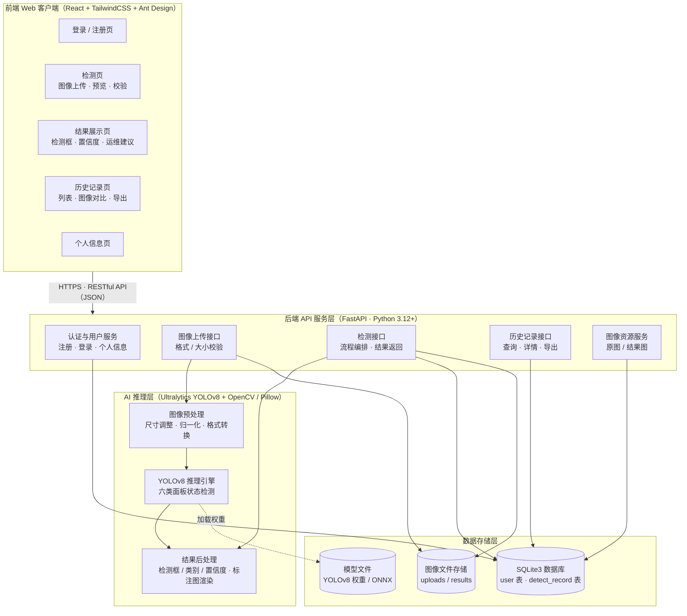
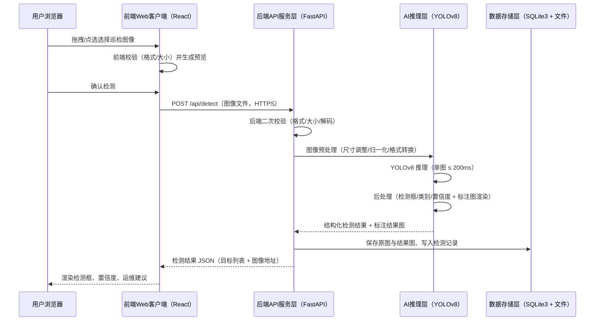
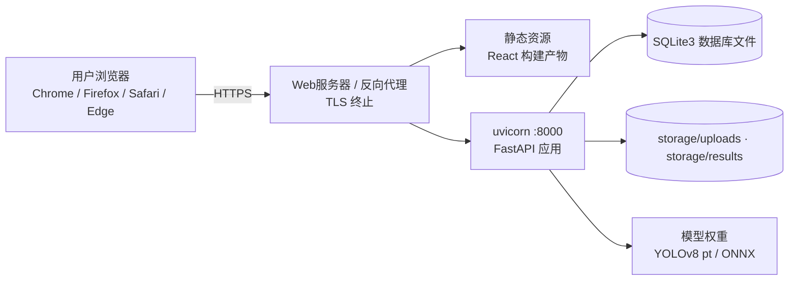

# 系统架构设计

| 项目 | 内容 |
|---|---|
| 项目名称 | 光伏面板缺陷检测系统 |
| 文档版本 | V1.0.0 |
| 编写日期 | 2026-09-14 |
| 架构风格 | 前后端分离的B/S架构 |
| 编制依据 | 《光伏面板缺陷检测系统项目任务书V1.0.0》第三章技术方案 |

## 1 分层总览

系统自上而下分为四层：前端Web客户端、后端API服务层、AI推理层、数据存储层。前端与后端之间通过HTTPS承载的RESTful API（JSON）通信；AI推理层由后端API服务层调用，不直接暴露给前端；数据存储层同时承载结构化数据（SQLite3）与非结构化文件（图像、模型权重）。

## 2 系统架构图

## 3 分层职责

### 3.1 前端Web客户端

- 技术栈：React + TailwindCSS + Ant Design
- 职责：用户界面展示、图像上传（拖拽/点选/预览/校验）、与后端API通信、检测结果可视化（检测框、置信度、运维建议）、历史记录展示与导出、个人信息管理
- 页面：登录/注册页、检测页（上传与结果展示）、历史记录页、个人信息页
- 适配：响应式设计，适配PC端与移动端浏览器（Chrome、Firefox、Safari、Edge最新两个版本）

### 3.2 后端API服务层

- 技术栈：FastAPI（Python 3.12+）
- 职责：用户认证与用户管理、图像上传校验、检测流程编排（调用预处理与推理）、检测结果持久化与返回、历史记录查询与导出、图像静态资源服务
- 对外提供RESTful API，接口清单见 spec.md 第4章
- 承担全部业务规则校验（前端校验仅作体验优化，后端校验为最终防线）

### 3.3 AI推理层

- 技术栈：Ultralytics YOLOv8 + OpenCV/Pillow
- 职责：
  - 图像预处理：尺寸调整、归一化、格式转换
  - 模型推理：六类面板状态目标检测（COCO预训练迁移学习，经量化、剪枝、ONNX导出优化）
  - 结果后处理：输出检测框、类别、置信度，渲染标注结果图
- 模型权重由算法目录训练产出（algorithm/runs），部署时复制至后端服务（backend/app/ml/weights）

### 3.4 数据存储层

- SQLite3数据库：user表（用户）、detect_record表（检测记录），表结构见 db_design.md
- 文件存储：上传原图（storage/uploads）、标注结果图（storage/results）
- 模型文件：YOLOv8权重（pt/ONNX）

## 4 核心检测流程时序图

## 5 技术选型

与任务书3.2核心技术表一致，未做增改：

| 技术模块 | 技术选型 | 主要功能 | 所在层 |
|---|---|---|---|
| 开发语言 | Python 3.12+ | 全栈开发与算法实现 | 后端API层 / AI推理层 |
| 深度学习框架 | PyTorch / Ultralytics | 模型训练与推理 | AI推理层 |
| 网络模型 | YOLOv8（COCO预训练） | 面板缺陷目标检测与分类 | AI推理层 |
| 图像处理 | OpenCV / PIL | 图像预处理与增强 | AI推理层 / 后端API层 |
| 后端服务 | FastAPI | RESTful API服务 | 后端API服务层 |
| 前端框架 | React | Web界面开发 | 前端Web客户端 |
| UI组件库 | TailwindCSS / Ant Design | 界面组件 | 前端Web客户端 |
| 数据库 | sqlite3 | 数据持久化存储 | 数据存储层 |

## 6 部署视图

部署要点：

- 前端经 Vite 构建为静态产物，由 Nginx 反向代理托管，`/api` 转发至 uvicorn :8000；开发阶段由 Vite dev server 代理 `/api`（D10 已定稿）
- 后端以uvicorn运行FastAPI应用，AI推理层随后端进程加载模型
- HTTPS在反向代理处终止TLS；开发阶段可先用HTTP，交付前切换HTTPS
- SQLite为单文件数据库，随应用部署，无需独立数据库服务
