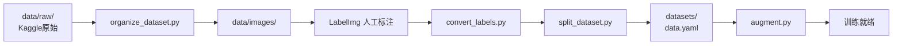

# 数据集准备完整流程（Dataset Readme）

| 项目 | 内容 |
|---|---|
| 所属阶段 | 阶段1：数据预处理与数据集构建 |
| 脚本位置 | algorithm/scripts/（organize_dataset.py、convert_labels.py、split_dataset.py、augment.py） |
| 文档版本 | V1.0.0 |
| 编写日期 | 2026-09-14 |
| 设计规格 | [dataset_spec.md](dataset_spec.md)（决策点D11–D15已按建议默认值执行） |

## 1 流程总览

从Kaggle原始分类数据集到YOLOv8可训练数据集共5步，其中2步人工、3步脚本：

| 步骤 | 操作 | 执行方式 | 产物 |
|---|---|---|---|
| 1 数据集下载 | Kaggle注册下载、解压放置 | 人工 | data/raw/ |
| 2 目录组织 | organize_dataset.py | 脚本 | data/images/、predefined_classes.txt、annotate_todo.txt |
| 3 LabelImg标注 | 画目标框（六类） | 人工 | data/labels_xml/（PascalVOC XML） |
| 4 标注转换 | convert_labels.py | 脚本 | data/labels/（YOLO txt） |
| 5 划分与增强 | split_dataset.py、augment.py | 脚本 | datasets/（含data.yaml，训练就绪） |



## 2 环境准备

```bash
# 在 algorithm/ 目录下创建Python 3.12+虚拟环境并安装依赖
python -m venv .venv
# Windows
.venv\Scripts\activate
# macOS / Linux
# source .venv/bin/activate
pip install -r requirements.txt
```

LabelImg为独立标注工具，不随本项目requirements安装。其在Python 3.12下安装易失败，建议两种方式任选：

- 方式一：单独创建Python 3.9–3.11环境安装：`pip install labelImg`
- 方式二：使用LabelImg官方Windows可执行包（GitHub releases下载）

## 3 数据集下载与放置

数据集地址（注册后免费下载）：https://www.kaggle.com/datasets/pythonafroz/solar-panel-images

1. 注册/登录Kaggle，进入上述数据集页面，Download下载压缩包；
2. 解压后得到按6类组织的图像文件夹（Clean、Dusty、Bird-drop、Electrical-damage、Physical-Damage、Snow-Covered，各类约100–900+张）；
3. 将解压内容放入 `algorithm/data/raw/`，目录形如：

```text
algorithm/data/raw/
├── Clean/
├── Dusty/
├── Bird-drop/
├── Electrical-damage/
├── Physical-Damage/
└── Snow-Covered/
```

该数据集无边界框标注（分类数据集），目标框需在第4步用LabelImg人工标注，这是任务书3.3的既定流程。

## 4 步骤一：目录组织

```bash
# 在 algorithm/ 目录执行（脚本可任意目录执行，路径默认按脚本位置定位）
python scripts/organize_dataset.py
```

产物与说明：

| 产物 | 说明 |
|---|---|
| data/images/ | 统一命名的图像：`{类别英文标识}_{原文件名}`，如 `Bird-drop_img001.jpg` |
| data/labels_xml/ | 空目录，下一步LabelImg的XML保存位置 |
| data/predefined_classes.txt | 六类英文标识，LabelImg类别预置文件 |
| data/annotate_todo.txt | 全部待标注图像清单，标注完成后用于查漏 |
| data/organize_report.txt | 各类别图像数、忽略文件、重名去重明细 |

## 5 步骤二：LabelImg人工标注

启动（命令行方式）：

```bash
labelImg data/images data/predefined_classes.txt
```

（可执行包方式：打开LabelImg后，Open Dir 选择 `data/images`，Change Save Dir 选择 `data/labels_xml`。）

标注要点：

1. 左侧工具栏确认保存格式为 **PascalVOC**（默认），若为Yolo请点击切换；
2. 类别必须从预置列表（六类英文标识）中选择，不要手动输入新名称——convert脚本对六类之外的类别名会判为转换失败；
3. 每张图像至少画1个框，框紧贴目标（面板或缺陷区域）边缘；
4. 快捷键：W画框、D下一张、A上一张、Ctrl+S保存；
5. 标注进度对照 `data/annotate_todo.txt`（已标注的图像不会自动从清单移除，以LabelImg实际打开为准；查漏方法见convert报告）。

## 6 步骤三：标注转换（XML → YOLO txt）

```bash
python scripts/convert_labels.py --preview 20
```

`--preview 20` 会抽样生成20张框叠加图到 `data/preview/`，打开人工核对框位置与类别是否正确（预览图标签为英文标识）。

产物：`data/labels/` 下与图像同名的txt（每行 `class_id cx cy w h`，归一化坐标）、`data/convert_report.txt`。

报告重点看三处：

- **未标注图像清单**：这些图没有XML，需回到LabelImg补标后重跑本脚本；
- **错误清单**：类别名不在六类映射内、XML解析失败等，修正后重跑；
- **各类别目标框总数**：某类为0说明该类漏标。

## 7 步骤四：数据集划分（8:1:1）

```bash
python scripts/split_dataset.py --preview 12
```

产物：

| 产物 | 说明 |
|---|---|
| datasets/images/{train,val,test}/ | 按8:1:1分层划分的图像（按类别前缀分层，各类比例与整体一致） |
| datasets/labels/{train,val,test}/ | 与图像成对的YOLO标注 |
| datasets/data.yaml | Ultralytics YOLOv8训练配置，阶段2直接 `model.train(data="datasets/data.yaml")` |
| datasets/class_weights.json | 训练集各类目标框数与频率倒数权重（均值归一为1） |
| datasets/split_report.txt | 划分明细：各split各类图像数、排除清单、小类别告警 |

规则说明：未标注图像会被排除并列入报告（不当负样本，避免拉低缺陷召回）；某类图像不足3张时全部进train并在报告告警；因保底与取整，实际比例与8:1:1允许±2张偏差。

## 8 步骤五：数据增强与类别加权采样

```bash
python scripts/augment.py --count 200 --clean
```

| 参数 | 默认 | 说明 |
|---|---|---|
| --count | 200 | 生成增强样本数量 |
| --ops | flip,rotate,brightness,mosaic | 启用的算子，逗号分隔 |
| --rotate-deg | 15 | 随机旋转最大角度 |
| --mosaic-size | 640 | Mosaic输出边长 |
| --seed | 42 | 随机种子（可复现） |
| --clean | 关 | 运行前清除既有augm_样本，重复运行建议带上 |

算子行为：随机翻转（水平p=0.5、垂直p=0.2，框坐标镜像）；随机旋转（±15°，框取旋转后外接矩形并裁剪）；亮度扰动（alpha 0.8–1.2、beta ±30，框不变）；Mosaic（4图2×2拼成640×640，标签平移合并、越界裁剪）。所有算子同步变换标注框。

类别加权采样：单图权重=其所含类别频率倒数的最大值，含稀有类（如电损伤、积雪）的图像优先被增强，缓解六类不均。增强样本以 `augm_` 前缀写回train目录，data.yaml无需改动。

`--count` 建议值：先跑默认200观察 `datasets/aug_report.txt` 中"增强前→增强后"的类别分布，若稀有类仍明显偏少，可将count提到300–500再跑（配合--clean）。

## 9 常见问题

| 问题 | 原因与处理 |
|---|---|
| convert报告中"未标注图像"很多 | 这些图像还没在LabelImg画框，回到步骤二补标 |
| convert报"未知类别名" | LabelImg里手动输入了六类以外的名称；改用预置类别列表重标该文件 |
| split报告出现"无法分层" | 图像文件名无类别前缀且标注为空；用organize产出的命名即可避免 |
| split比例不是严格8:1:1 | 各类保底与取整导致，±2张属正常，看split_report各类明细 |
| 某类全部进了train | 该类图像不足3张，触发小类别保底；有条件可补充该类数据 |
| augment重复运行样本越积越多 | 不带--clean时旧augm_样本保留；重复运行统一加--clean |
| 预览图标签是英文 | OpenCV无法渲染中文，预览仅用于核对框位置；中文类别见pv_classes.py映射 |

## 10 产物清单与验收对照

全部步骤完成后应具备（对照 [dataset_spec.md](dataset_spec.md) 第7章验收标准）：

```text
algorithm/
├── data/
│   ├── raw/                    # 原始数据集（保留）
│   ├── images/                 # organize输出
│   ├── labels_xml/             # LabelImg XML
│   ├── labels/                 # YOLO txt
│   └── preview/                # 转换抽查预览（--preview时）
└── datasets/
    ├── images/{train,val,test}/
    ├── labels/{train,val,test}/
    ├── data.yaml               # YOLOv8训练配置
    ├── class_weights.json      # 类别权重
    ├── split_report.txt
    └── aug_report.txt
```

验收自查：图像与标注一一配对无孤立文件；train:val:test≈8:1:1且各类分层比例偏差≤5%；增强样本框坐标有效（0–1）；data.yaml可被 `ultralytics.YOLO().train(data=...)` 直接接受。完成后即可进入阶段2模型训练。
