# 数据集处理脚本规格说明书（Dataset Spec）

| 项目 | 内容 |
|---|---|
| 项目名称 | 光伏面板缺陷检测系统 |
| 阶段 | 阶段1：数据预处理与数据集构建 |
| 文档版本 | V1.0.0 |
| 编写日期 | 2026-09-14 |
| 文档状态 | 已确认（2026-09-14，D11–D15按建议默认值执行；脚本已交付并通过端到端冒烟测试） |
| 编制依据 | 《光伏面板缺陷检测系统项目任务书V1.0.0》3.3算法流程；docs/spec.md 第6章；docs/tasks.md 阶段1 |

## 1 阶段目标与交付物

将Kaggle "Solar Panel Images" 分类数据集加工为YOLOv8可直接训练的目标检测数据集：目录规范化 → LabelImg标注 → XML转YOLO txt → 8:1:1划分 → 数据增强与类别加权采样。本阶段只产出处理脚本与流程文档，**不包含任何数据集文件**。

| # | 交付物 | 类型 | 说明 |
|---|---|---|---|
| 1 | algorithm/scripts/pv_classes.py | 共享常量 | 六类映射表（ID/英文标识/中文名），供各脚本引用 |
| 2 | algorithm/scripts/organize_dataset.py | 处理脚本 | 数据集目录组织 |
| 3 | algorithm/scripts/convert_labels.py | 处理脚本 | LabelImg XML → YOLO txt 标注转换 |
| 4 | algorithm/scripts/split_dataset.py | 处理脚本 | 8:1:1划分 + data.yaml生成 |
| 5 | algorithm/scripts/augment.py | 处理脚本 | 数据增强 + 类别加权采样 |
| 6 | algorithm/requirements.txt | 依赖清单 | 阶段1锁定依赖版本 |
| 7 | docs/dataset_readme.md | 流程文档 | 数据准备完整流程（下载→标注→转换→划分→增强） |
| 8 | docs/dataset_spec.md | 规格说明 | 本文档 |

数据集下载地址（注册后免费下载）：
https://www.kaggle.com/datasets/pythonafroz/solar-panel-images

## 2 运行环境与依赖

| 项 | 内容 |
|---|---|
| Python | 3.12+ |
| 直接依赖 | ultralytics、opencv-python、pillow、numpy（ultralytics传递依赖，脚本直接使用） |
| 无需额外引入 | yaml文件手工生成（data.yaml结构简单，不引入PyYAML） |

每个脚本头部写明：功能说明、运行环境、运行命令示例、数据集下载地址。所有脚本通过argparse提供参数，默认值即为本项目目录约定，开箱即用。

## 3 数据流总览

```mermaid
flowchart LR
    A["Kaggle 下载<br/>data/raw/<br/>按6类文件夹组织"] --> B["organize_dataset.py<br/>目录组织"]
    B --> C["data/images/<br/>统一命名图像<br/>类别前缀_原文件名"]
    C --> D["LabelImg 人工标注<br/>（用户手动步骤）"]
    D --> E["data/labels_xml/<br/>PascalVOC XML"]
    E --> F["convert_labels.py<br/>XML → YOLO txt"]
    F --> G["data/labels/<br/>YOLO标注"]
    C --> H["split_dataset.py<br/>8:1:1 分层划分"]
    G --> H
    H --> I["datasets/<br/>images + labels<br/>data.yaml + class_weights"]
    I --> J["augment.py<br/>随机翻转/旋转/亮度/Mosaic<br/>类别加权采样"]
    J --> K["datasets/images/train<br/>augm_ 前缀增强样本"]
    K --> L["YOLOv8 训练就绪<br/>（阶段2 train.py 直接引用 data.yaml）"]
```



数据集现状约束（调研已确认）：Kaggle该数据集为分类数据集，图像按6类文件夹组织、无边界框标注、无train/test预划分，各类约100–900+张。因此流程中LabelImg人工标注为必需步骤（任务书3.3要求），脚本负责标注前后的全部自动化环节。

## 4 类别与标签映射

类别ID沿用PRD第4章定义，映射关系全局唯一，集中定义在 pv_classes.py：

| class_id | 英文标识（Kaggle文件夹名） | 中文名称 | 类别性质 |
|---|---|---|---|
| 0 | Clean | 清洁 | 正常状态 |
| 1 | Dusty | 积灰 | 缺陷 |
| 2 | Bird-drop | 鸟粪 | 缺陷 |
| 3 | Electrical-damage | 电损伤 | 缺陷 |
| 4 | Physical-Damage | 物理损伤 | 缺陷 |
| 5 | Snow-Covered | 积雪 | 缺陷 |

映射容错规则：文件夹名与类别标识按不区分大小写、忽略连字符/下划线差异匹配（数据集存在 Bird-drop、Physical-Damage 等大小写与连字符不一致的命名）。XML中出现的类别名必须能映射到六类之一，无法映射的进入错误清单并中止该文件转换。

## 5 脚本详细设计

### 5.0 pv_classes.py（共享类别映射）

- 内容：`CLASSES`列表（id→(英文标识, 中文名)）、`NAME_TO_ID`映射（含容错键：小写、连字符转下划线）、六类画框颜色（供预览/渲染用）
- 无CLI，纯常量模块，其余脚本 `from pv_classes import ...`

### 5.1 organize_dataset.py（数据集目录组织）

| 项 | 内容 |
|---|---|
| 输入 | `data/raw/` 下6个类别文件夹（Kaggle解压后原样放入） |
| 输出 | `data/images/`（统一命名图像）、`data/labels_xml/`（空目录，LabelImg保存位置）、`data/predefined_classes.txt`（LabelImg类别预置文件）、`data/annotate_todo.txt`（标注任务清单）、`data/organize_report.txt`（统计报告） |
| CLI | `python organize_dataset.py --raw data/raw --out data --mode copy` |
| 默认 | `--mode copy`（保留raw原始数据；`move`可选） |

核心规则：

1. 递归扫描raw下图像文件（jpg/jpeg/png/bmp，扩展名不区分大小写），非图像文件忽略并计入报告；
2. 统一命名：`{类别标识}_{原文件名}`；不同类别文件夹存在同名文件时追加序号去重；命名冲突全部记录于报告；
3. 生成LabelImg标注所需配套：predefined_classes.txt（六类英文标识，保证标注类别名与映射一致）、annotate_todo.txt（待标注图像清单，标注完成后可对照查漏）；
4. 报告输出：各类别图像数、总数、忽略文件数、重命名明细。

### 5.2 convert_labels.py（LabelImg XML → YOLO txt）

| 项 | 内容 |
|---|---|
| 输入 | `data/labels_xml/`（LabelImg保存的PascalVOC XML）、`data/images/`（取图像宽高） |
| 输出 | `data/labels/`（与图像同名的txt标注）、`data/convert_report.txt` |
| CLI | `python convert_labels.py --xml-dir data/labels_xml --img-dir data/images --out-dir data/labels` |

转换规则：

1. PascalVOC像素坐标 `(xmin, ymin, xmax, ymax)` → YOLO归一化坐标 `(cx, cy, w, h)`，公式：`cx=(xmin+xmax)/2/W`，其余同理，W/H取自对应图像实际尺寸；
2. 坐标clamp到[0,1]；越界框修正后告警，宽或高为0的框丢弃并告警；
3. XML含0个目标 → 生成空txt（YOLO负样本约定，正常情况不应出现，报告单列）；
4. 类别名按第4章映射表转换；未知类别名 → 该文件转换失败，进入错误清单，不中断整体；
5. 报告输出：转换成功/失败数、每类目标框总数、告警明细、有图无XML清单（未标注，供补标）。

### 5.3 split_dataset.py（8:1:1划分 + data.yaml）

| 项 | 内容 |
|---|---|
| 输入 | `data/images/`、`data/labels/` |
| 输出 | `datasets/images/{train,val,test}/`、`datasets/labels/{train,val,test}/`、`datasets/data.yaml`、`datasets/class_weights.json`（类别频率，供训练加权）、`datasets/split_report.txt` |
| CLI | `python split_dataset.py --img-dir data/images --label-dir data/labels --out datasets --ratio 0.8 0.1 0.1 --seed 42` |

划分规则：

1. 分层抽样：按文件名类别前缀（organize生成）分层，保证各split内类别比例与整体一致；
2. 小类别保底：某类图像数≥3时，val与test各保底1张该类；不足3张的类别全部进train并告警；
3. 未标注图像（有图无txt）默认排除出数据集，清单写入报告 [D12]；
4. 图像与标注成对复制到目标目录（复制而非移动/链接，保证raw与data完整）；
5. data.yaml内容：`path/train/val/test`路径、六类`names`映射，`names`使用英文标识 [D11]；
6. class_weights.json：训练集各类目标框数与频率倒数权重，供阶段2加权采样直接读取；
7. 报告输出：各split图像数与占比、每split每类图像数、分层偏差核对。

### 5.4 augment.py（数据增强 + 类别加权采样）

| 项 | 内容 |
|---|---|
| 输入 | `datasets/images/train/`、`datasets/labels/train/` |
| 输出 | 增强图像与标注写回train目录（`augm_`前缀 [D13]）、`datasets/aug_report.txt` |
| CLI | `python augment.py --dataset datasets --count 200 --ops flip,rotate,brightness,mosaic --seed 42 --clean` |

增强算子（均需同步变换标注框）：

| 算子 | 规则 | 默认参数 |
|---|---|---|
| 随机翻转 | 水平翻转：框x坐标镜像 `cx→1-cx`；垂直翻转同理 | 水平p=0.5，垂直p=0.2 |
| 随机旋转 | 小角度旋转，bbox四角点旋转后取轴对齐外接框，clip到图像内 [D14] | ±15°均匀采样 |
| 亮度扰动 | 亮度/对比度线性变换，框不变 | alpha 0.8–1.2，beta ±30 |
| Mosaic拼接 | 4张图2×2拼接，各图缩放至半幅，标签坐标平移合并，越界框裁剪、空框样本剔除 | 输出640×640 |

类别加权采样规则：

1. 读取train标注，统计各类目标框频率；
2. 单图采样权重 = 该图所含类别的频率倒数最大值（含稀有类的图优先被增强）；
3. 按 `--count` 数量加权采样生成增强样本，每种增强操作等概率组合选取（mosaic按需消耗4张源图）；
4. `--clean` 先清除既有`augm_`文件，保证重复运行幂等；
5. 报告输出：增强前后各类目标框分布对比、生成样本清单。

### 5.5 docs/dataset_readme.md（数据准备完整流程）

面向项目使用者的操作手册，覆盖：Kaggle注册与数据集下载、解压放置路径、organize运行、LabelImg安装与标注操作要点（保存目录、类别选择、框规范）、convert/split/augment逐步运行命令、常见问题（未标注清单、类别名不识别、小类别告警）、产出校对方法（各report说明）。文档随脚本一起交付，命令与脚本CLI严格一致。

## 6 目录结构（阶段1产出后）

```text
algorithm/
├── data/                      # 运行时数据（不入版本库）
│   ├── raw/                   # Kaggle原始数据集（用户下载解压放入）
│   ├── images/                # organize输出
│   ├── labels_xml/            # LabelImg标注输出
│   └── labels/                # convert输出（YOLO txt）
├── datasets/                  # split输出，YOLO训练根目录
│   ├── images/{train,val,test}/
│   ├── labels/{train,val,test}/
│   ├── data.yaml
│   ├── class_weights.json
│   └── aug_report.txt / split_report.txt（报告随阶段生成）
├── scripts/
│   ├── pv_classes.py
│   ├── organize_dataset.py
│   ├── convert_labels.py
│   ├── split_dataset.py
│   └── augment.py
└── requirements.txt
```

与 docs/project_structure.md 阶段1部分一致；报告文件（*_report.txt）为脚本运行时产物。

## 7 验收标准

1. 五个脚本 + requirements + dataset_readme 全部交付，`python -m py_compile` 全部通过；
2. 脚本默认参数即按约定目录运行，无需手工改路径；
3. 转换正确性：抽查XML与txt，坐标换算一致（归一化框与像素框互算还原误差 < 1像素）；
4. 划分正确性：train:val:test ≈ 8:1:1（±2张容差），各类别分层比例偏差 ≤ 5%，图像与标注一一配对；
5. 增强正确性：增强样本的框均在图像范围内、归一化坐标有效[0,1]；加权采样后稀有类目标框占比提升（报告可核）；
6. data.yaml可被 `ultralytics.YOLO().train(data=...)` 直接接受；
7. 不含任何数据集图像与标注文件本体（约束2）。

## 8 待确认决策点（编号衔接spec.md，D11–D15）

| 编号 | 决策点 | 说明 | 建议默认值 |
|---|---|---|---|
| D11 | data.yaml类别名语言 | 英文标识训练日志无乱码；中文由应用层映射展示 | 英文标识（Clean/Dusty/…） |
| D12 | 未标注图像的划分处理 | 有图无XML时：排除 or 空标签当负样本 | 排除并列清单（负样本会拉低召回） |
| D13 | 增强样本存放位置 | 并入train（augm_前缀）或独立目录 | 并入train，data.yaml无需改 |
| D14 | 旋转角度策略 | 小角度±15°（外接框法）或仅90°倍数（无外接框膨胀） | ±15°随机 |
| D15 | 标注可视化抽查 | convert/split增加`--preview N`抽样生成框叠加图，便于人工核对标注质量 | 提供（低成本，标注QA刚需） |

## 9 任务清单（确认后执行）

- [x] T1 生成 algorithm/requirements.txt 与 pv_classes.py
- [x] T2 编写 organize_dataset.py（目录组织）
- [x] T3 编写 convert_labels.py（XML → YOLO txt，含D12、D15逻辑）
- [x] T4 编写 split_dataset.py（分层划分 + data.yaml + class_weights）
- [x] T5 编写 augment.py（四算子 + 类别加权采样）
- [x] T6 编写 docs/dataset_readme.md（数据准备完整流程）
- [x] T7 全部脚本 py_compile 静态自检 + CLI帮助信息核对
- [x] T8 更新 docs/tasks.md 阶段1勾选状态

2026-09-14 交付完成。附加验证：以合成微数据集（24张噪声图，临时目录）跑通 organize→convert→split→augment 全流程，坐标互算误差<1px、未标注排除逻辑、划分配对、增强坐标有效性均通过；测试数据未进入项目目录。
