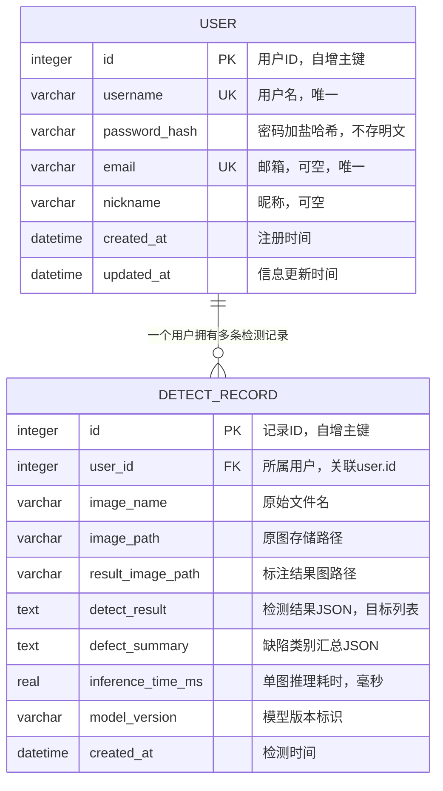

# 数据库设计（SQLite3）

| 项目 | 内容 |
|---|---|
| 项目名称 | 光伏面板缺陷检测系统 |
| 数据库 | SQLite3（单文件数据库） |
| 文档版本 | V1.0.0 |
| 编写日期 | 2026-09-14 |
| 表范围 | user（用户表）、detect_record（检测记录表） |

## 1 设计概述

数据库采用SQLite3，存储用户信息与检测历史记录两类核心数据，与应用同机部署，无需独立数据库服务。图像文件不入库，以文件形式存储于 storage 目录，数据库中保存路径引用。

约定：

- 每个连接须开启外键约束：`PRAGMA foreign_keys = ON;`（SQLite默认关闭）
- 时间字段使用 `datetime('now', 'localtime')` 生成东八区本地时间
- 建表脚本由后端初始化脚本执行（backend/app/db/init_db.py），应用启动时自动建库

## 2 ER图



## 3 user 表（用户表）

### 3.1 建表语句

```sql
CREATE TABLE user (
    id            INTEGER       PRIMARY KEY AUTOINCREMENT,
    username      VARCHAR(50)   NOT NULL,
    password_hash VARCHAR(255)  NOT NULL,
    email         VARCHAR(100),
    nickname      VARCHAR(50),
    created_at    DATETIME      NOT NULL DEFAULT (datetime('now', 'localtime')),
    updated_at    DATETIME      NOT NULL DEFAULT (datetime('now', 'localtime'))
);

CREATE UNIQUE INDEX idx_user_username ON user (username);
CREATE UNIQUE INDEX idx_user_email    ON user (email) WHERE email IS NOT NULL;
```

### 3.2 字段说明

| 字段 | 类型 | 约束 | 说明 |
|---|---|---|---|
| id | INTEGER | 主键，AUTOINCREMENT | 用户唯一标识 |
| username | VARCHAR(50) | NOT NULL，唯一索引 | 登录用户名，2–30字符 |
| password_hash | VARCHAR(255) | NOT NULL | 密码加盐哈希值（bcrypt/argon2），任何环节不存明文 |
| email | VARCHAR(100) | 可空，部分唯一索引 | 邮箱，填写时须唯一 |
| nickname | VARCHAR(50) | 可空 | 昵称，个人信息展示用 |
| created_at | DATETIME | NOT NULL | 注册时间，默认当前时间 |
| updated_at | DATETIME | NOT NULL | 最近更新时间，修改个人信息与密码时刷新 |

### 3.3 索引设计

| 索引名 | 类型 | 字段 | 用途 |
|---|---|---|---|
| idx_user_username | UNIQUE | username | 注册查重与登录查询 |
| idx_user_email | UNIQUE（部分索引） | email（IS NOT NULL） | 邮箱查重；允许空值不参与唯一约束 |
| （主键索引） | — | id | INTEGER PRIMARY KEY自带rowid索引 |

## 4 detect_record 表（检测记录表）

### 4.1 建表语句

```sql
CREATE TABLE detect_record (
    id                INTEGER        PRIMARY KEY AUTOINCREMENT,
    user_id           INTEGER        NOT NULL,
    image_name        VARCHAR(255)   NOT NULL,
    image_path        VARCHAR(500)   NOT NULL,
    result_image_path VARCHAR(500),
    detect_result     TEXT           NOT NULL,
    defect_summary    TEXT,
    inference_time_ms REAL,
    model_version     VARCHAR(50)    NOT NULL,
    created_at        DATETIME       NOT NULL DEFAULT (datetime('now', 'localtime')),
    FOREIGN KEY (user_id) REFERENCES user (id) ON DELETE CASCADE
);

CREATE INDEX idx_detect_record_user_time ON detect_record (user_id, created_at DESC);
CREATE INDEX idx_detect_record_created   ON detect_record (created_at);
```

### 4.2 字段说明

| 字段 | 类型 | 约束 | 说明 |
|---|---|---|---|
| id | INTEGER | 主键，AUTOINCREMENT | 检测记录唯一标识 |
| user_id | INTEGER | NOT NULL，外键 | 所属用户，关联 user.id，级联删除 |
| image_name | VARCHAR(255) | NOT NULL | 用户上传的原始文件名 |
| image_path | VARCHAR(500) | NOT NULL | 原图存储路径（storage/uploads下相对路径） |
| result_image_path | VARCHAR(500) | 可空 | 标注结果图路径（storage/results下相对路径） |
| detect_result | TEXT | NOT NULL | 检测结果JSON字符串，结构见4.4 |
| defect_summary | TEXT | 可空 | 缺陷类别汇总JSON，如 {"积灰": 2, "鸟粪": 1}，供历史列表直接展示 |
| inference_time_ms | REAL | 可空 | 单图推理耗时（毫秒），用于200ms指标复核 |
| model_version | VARCHAR(50) | NOT NULL | 模型版本标识（如 yolov8s-v1.0），用于模型追踪 |
| created_at | DATETIME | NOT NULL | 检测时间，默认当前时间 |

### 4.3 外键与索引设计

**外键**：user_id → user.id，`ON DELETE CASCADE`——删除用户时级联删除其全部检测记录（应用层同步清理对应图像文件，数据库不负责文件删除）。

**索引**：

| 索引名 | 类型 | 字段 | 用途 |
|---|---|---|---|
| idx_detect_record_user_time | 复合 | user_id, created_at DESC | 历史列表主查询：按用户筛选并按时间倒序分页；最左前缀同时覆盖外键列 |
| idx_detect_record_created | 单列 | created_at | 按时间范围的查询与导出场景 |
| （主键索引） | — | id | 记录详情按主键查询 |

### 4.4 detect_result JSON结构

```json
{
  "image_size": {"width": 1920, "height": 1080},
  "targets": [
    {
      "class_id": 1,
      "class_name": "积灰",
      "confidence": 0.87,
      "bbox": [x1, y1, x2, y2]
    },
    {
      "class_id": 2,
      "class_name": "鸟粪",
      "confidence": 0.76,
      "bbox": [x1, y1, x2, y2]
    }
  ]
}
```

- bbox 为原图像素坐标系下的左上角、右下角坐标
- 未检出目标时 targets 为空数组，记录仍保存（对应PRD FR-3.4空结果处理）
- SQLite以TEXT存储JSON字符串，应用层解析；SQLite json_extract函数可用于按类别统计

## 5 设计说明

- **JSON存检测结果的原因**：单张图像检出目标数量不定，关系列无法表达变长列表；教学与单机场景下数据规模有限，JSON存储配合应用层解析即可满足查询需求，避免为一张表拆出第三张目标明细表。
- **数据规模与性能**：SQLite单机读写性能满足本项目并发场景；历史列表查询命中 (user_id, created_at) 复合索引。
- **数据安全**：密码仅存加盐哈希（bcrypt/argon2）；数据库文件级加密属部署层措施（SQLCipher/磁盘加密，见 spec.md 决策点 D5），不影响本表结构。
- **图像文件与记录的一致性**：图像文件存储于 storage 目录，数据库仅存路径；删除记录时由应用层同时删除对应文件。
