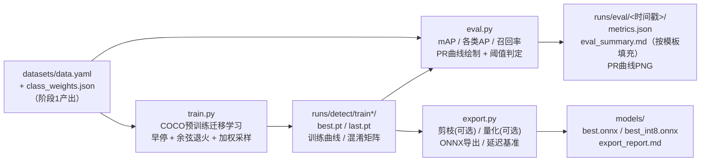

# 模型训练与导出脚本规格说明书（Model Training Spec）

| 项目 | 内容 |
|---|---|
| 项目名称 | 光伏面板缺陷检测系统 |
| 阶段 | 阶段2：深度学习模型开发与训练（含阶段3前置的模型导出） |
| 文档版本 | V1.0.0 |
| 编写日期 | 2026-09-14 |
| 文档状态 | 已交付（2026-09-14，D16–D23按建议默认值执行；train/eval/export冒烟验证通过，剪枝安全集合策略与INT8实测局限见第6章） |
| 编制依据 | 《光伏面板缺陷检测系统项目任务书V1.0.0》3.3算法流程、任务3/任务4；docs/spec.md 第5、6章；docs/dataset_spec.md（阶段1产出接口） |

## 1 阶段目标与交付物

基于阶段1产出的 `datasets/data.yaml` 与 `class_weights.json`，完成YOLOv8迁移学习训练、模型评估、模型优化与ONNX导出的全套工程脚本。本阶段**只提供训练执行逻辑，不含任何数据集文件，不在脚本内下载数据集**（约束2）；COCO预训练权重由Ultralytics框架在首次训练时自动从官方源获取（迁移学习必需，见第4.1节说明）。

| # | 交付物 | 类型 | 说明 |
|---|---|---|---|
| 1 | algorithm/train.py | 训练脚本 | COCO预训练迁移学习：联合损失、AdamW/SGD、余弦退火、验证集早停、类别加权采样、断点续训 |
| 2 | algorithm/eval.py | 评估脚本 | mAP@0.5、各类别AP、缺陷类别召回率、PR曲线绘制、指标阈值判定 |
| 3 | algorithm/export.py | 导出脚本 | 剪枝（可选）、量化（可选）、ONNX导出、推理延迟基准 |
| 4 | docs/model_eval_report.md | 报告模板 | 评估报告模板：指标表格、PR曲线说明、性能目标阈值、模型局限性 |
| 5 | algorithm/requirements.txt | 依赖更新 | 新增onnx、onnxruntime；matplotlib显式声明；torch安装说明注释 |
| 6 | docs/model_train_spec.md | 规格说明 | 本文档 |

## 2 运行环境与依赖

| 项 | 内容 |
|---|---|
| Python | 3.12+ |
| 深度学习框架 | PyTorch + Ultralytics（torch版本不锁死：GPU/CPU wheel由用户按硬件自行安装，requirements.txt中写明安装指引注释） |
| 直接依赖 | ultralytics（训练/评估/导出）、matplotlib（PR曲线绘制，ultralytics传递依赖、此处显式声明）、onnx + onnxruntime（导出与量化、ONNX精度核对、延迟基准） |
| 可选依赖 | torch-pruning（`--prune` 结构化剪枝，默认关闭，不开启剪枝无需安装） |

脚本头部统一写明：功能说明、运行环境、运行命令示例、前置条件（数据集就绪路径）、数据集下载地址（Kaggle，人工步骤）。

## 3 数据流总览



典型执行序列（数据集就绪后）：

```bash
python train.py                       # 1. 训练（产物 runs/detect/trainN/）
python eval.py                        # 2. 测试集评估（自动选取最新best.pt）
python export.py --int8 --benchmark   # 3. 导出ONNX并测延迟（产物 models/）
```

## 4 train.py 训练脚本设计

### 4.1 迁移学习与预训练权重

- 默认加载 `yolov8s.pt`（COCO预训练，D16）；Ultralytics首次运行时自动从官方源下载（约22MB）至当前目录，离线环境可手工放置同路径；
- 迁移方式：加载预训练骨干与检测头权重，输出层适配6类（nc=6由data.yaml自动解析）；
- 训练产物：`runs/detect/trainN/` 下 `best.pt`（验证fitness最优）、`last.pt`（续训用）、`results.png`（损失与mAP曲线）、混淆矩阵与验证batch可视化（框架自动生成）。

### 4.2 关键超参数（CLI全部可配，代码内逐项中文注释，约束1）

| 参数 | 默认值 | 含义与理由 |
|---|---|---|
| --weights | yolov8s.pt | COCO预训练权重，迁移学习起点 |
| --data | datasets/data.yaml | 阶段1生成的数据集配置（path/train/val/test/6类names） |
| --epochs | 150 | 最大训练轮数；配合早停实际通常更早结束 |
| --patience | 30 | **早停耐心值**：验证集fitness连续30轮无提升则停止，防过拟合。fitness=0.1×mAP@0.5+0.9×mAP@0.5:0.95 |
| --batch | 16 | 批大小；显存不足可降8，CPU训练建议4 |
| --imgsz | 640 | 输入边长（与部署推理一致，spec.md 5.1） |
| --optimizer | AdamW | 优化器，可选SGD（D17）。AdamW对小数据集收敛快；SGD配合更大lr0泛化更稳 |
| --lr0 | 0.001 | 初始学习率（AdamW典型值；切SGD建议0.01） |
| --lrf | 0.01 | 最终学习率系数：最终lr = lr0 × lrf |
| --cos-lr | True | **余弦退火**：lr按余弦曲线从lr0平滑衰减至lr0×lrf（False时为线性衰减），末期小步长利于精细收敛 |
| --momentum | 0.937 | SGD动量 / AdamW的β₁ |
| --weight-decay | 0.0005 | L2正则系数，抑制过拟合 |
| --warmup-epochs | 3.0 | 预热轮数：前几轮从低lr/低动量线性升至设定值，保护预训练权重不被初期大梯度破坏 |
| --warmup-momentum | 0.8 | 预热期初始动量 |
| --warmup-bias-lr | 0.1 | 预热期bias参数学习率 |
| --box | 7.5 | 边框回归损失（CIoU）增益 |
| --cls | 0.5 | 分类损失（BCE）增益 |
| --dfl | 1.5 | Distribution Focal Loss增益（YOLOv8边框分布学习损失） |
| --hsv-h / --hsv-s / --hsv-v | 0.015 / 0.7 / 0.4 | 在线色彩/饱和度/亮度扰动幅度 |
| --degrees | 0.0 | 在线旋转角度，**置0**：旋转增强已由阶段1离线完成，避免重复（D23） |
| --translate / --scale | 0.1 / 0.5 | 在线平移/缩放扰动 |
| --fliplr | 0.5 | 水平翻转概率 |
| --mosaic | 1.0 | Mosaic四图拼接概率（在线增强） |
| --close-mosaic | 10 | 最后10轮关闭Mosaic，让模型在真实分布上完成收敛 |
| --label-smoothing | 0.0 | 标签平滑（默认关闭，过拟合时可开0.05–0.1） |
| --amp | True | 混合精度训练（FP16），约省一半显存、提速 |
| --cache | False | 图像缓存（ram/disk可选），小数据集可开加速 |
| --device | auto | cuda可用则GPU，否则CPU并告警提示改用yolov8n+小batch |
| --workers | 8 | 数据加载进程数 |
| --project / --name | runs / train | 输出目录 |
| --resume | False | 从last.pt断点续训 |
| --seed | 42 | 随机种子，保证可复现（与阶段1一致） |
| --no-weighted-sampling | 关 | 关闭类别加权过采样（D19，默认开启） |

### 4.3 类别加权过采样（D19）

阶段1产出的 `class_weights.json` 提供训练集各类频率倒数权重。train.py默认开启加权采样：

1. 读取class_weights.json，对每张训练图计算权重 = 其标注中所含类别的最大权重；
2. 重复因子 = clamp(权重, 1, 3)（上限3，防数据集膨胀与严重过拟合稀有类）；
3. 生成 `datasets/images_train_weighted.txt`（按重复因子重复图像绝对路径）与 `datasets/data_train_weighted.yaml`（train指向该txt，val/test不变），以派生yaml训练；
4. `--no-weighted-sampling` 回退原始data.yaml（纯目录采样）。

说明：重复的图像共享同一标注文件，Ultralytics按txt行构建样本列表，天然支持重复条目；离线增强（阶段1 augm_样本）与在线增强叠加使用。

### 4.4 早停与最优权重保留

- 监控指标：每轮验证后的fitness = 0.1×mAP@0.5 + 0.9×mAP@0.5:0.95（Ultralytics口径）；
- 连续`--patience`轮未创新高 → 停止训练，best.pt保留历史最优；
- 训练结束打印最优轮次、各损失分量收敛情况、验证mAP摘要。

## 5 eval.py 评估脚本设计

### 5.1 双口径评估（互为核对）

| 口径 | 内容 | 用途 |
|---|---|---|
| 官方口径 | `model.val(split='test', plots=True)`：mAP@0.5、mAP@0.5:0.95、各类AP，框架自动出PR曲线与混淆矩阵 | 与社区结果可比对的权威数字 |
| 工程口径 | 自实现：全测试集 predict（conf=0.01低阈值收集）→ 按置信度扫描 → IoU=0.5贪心匹配 → 每类P/R点列 → 101点插值AP；召回率取conf=0.25工作点（与D7部署阈值一致，D22） | 反映部署真实行为，PR曲线绘制代码自主可控（任务书交付物要求） |

两口径mAP@0.5并列输出，偏差应<1%（数据与实现一致性自检）。

### 5.2 输入输出

| 项 | 内容 |
|---|---|
| 输入 | --weights（默认自动选取runs/下最新best.pt）、--data datasets/data.yaml、--split test、--conf 0.25、--match-iou 0.5（GT匹配IoU）、--nms-iou 0.45（与spec.md 5.1部署口径一致） |
| 输出 | `runs/eval/<时间戳>/`：metrics.json（全部指标）、pr_curve.png（六类PR曲线+micro平均，图例含各类AP）、pr_data.json（曲线原始点列）、eval_summary.md（按model_eval_report.md模板自动填充）、控制台中文指标表 |

### 5.3 阈值判定（验收线，PRD 6.1）

| 指标 | 阈值 | 判定 |
|---|---|---|
| mAP@0.5（测试集总体） | ≥ 0.75 | 达标/未达标 |
| 主要缺陷类别召回率（积灰、鸟粪、电损伤、物理损伤、积雪，conf=0.25工作点） | 每类 ≥ 0.80 | 逐类判定，清洁类仅参考不设线 |
| 单图推理耗时 | ≤ 200ms | 由export.py基准测试覆盖（D6硬件） |

- 未达标时eval.py给出调参建议方向（增强样本量/加权采样/模型规模/训练轮数），并以非零退出码标识（便于脚本化迭代）；
- 某类测试集样本数为0时明确告警"该类无评估样本"，不参与判定。

## 6 export.py 导出脚本设计

### 6.1 导出流水线

```
best.pt ──(可选)剪枝+微调──> pruned.pt ──> ONNX导出(FP32) ──(可选)INT8动态量化──> best_int8.onnx
                              │                                     │
                              └──────────── mAP核对(ONNX) ◄────────┘
                                            │
                                     延迟基准(benchmark)
                                            │
                              models/export_report.md（体积/精度/延迟对比+部署建议）
```

### 6.2 功能项

| 功能 | CLI | 说明 |
|---|---|---|
| ONNX导出 | 默认执行 | `model.export(format='onnx', imgsz=640, opset=12, simplify=True, dynamic=False, batch=1)`，固定batch=1匹配单图检测场景（D21） |
| FP16导出 | --half | 半精度ONNX（导出时需CUDA环境，文件减半） |
| INT8量化 | --int8 | onnxruntime动态量化（无需校准集）；仅量化MatMul/Gemm（卷积动态量化产生ConvInteger节点、CPU运行时不支持）。**冒烟实测局限**：YOLOv8为纯卷积结构，可量化算子极少，产物体积与FP32基本相同（如实呈现，避免答辩误述）；体积压缩依赖剪枝；升级路径为静态量化QDQ格式（Conv可量化、CPU支持，需校准数据集，待真实数据就绪后可选） |
| 结构化剪枝 | --prune --prune-ratio 0.2 | torch-pruning 1.6 L1范数裁剪**安全集合**：下采样Conv、SPPF入口/出口、C2f出口；避开C2f内部（动态split+残差对齐易破坏结构）与检测头（类别维度不可剪）。冒烟实测：17层全部剪枝成功、检测输出shape不变、参数量降至83.9%（ratio=0.2）。剪后自检输出shape一致性，可--finetune-epochs微调恢复精度；**默认关闭**（D20）：剪枝易掉点且恢复成本高，任务书定位为"尝试"项 |
| ONNX精度核对 | 默认执行 | `YOLO('best.onnx').val()`对比pt基线，mAP@0.5降幅>2%时告警并在报告中标注不建议部署该产物 |
| 延迟基准 | --benchmark | onnxruntime CPU会话：预处理(letterbox 640)+推理，warmup 10次后测100次，输出mean/p50/p95毫秒；同时测pt基线对比；核对≤200ms目标（报告注明测试硬件，D6） |
| 导出报告 | 默认执行 | models/export_report.md + manifest.json：各产物体积、精度、延迟对比表与部署建议 |

输出目录：`algorithm/models/`（新增，阶段3部署时拷贝至backend/app/ml/weights/，衔接project_structure.md）。

## 7 docs/model_eval_report.md 模板设计

模板含`{{占位符}}`（eval.py自动填充）与人工补充栏（硬件信息、复核人），章节：

1. **评估概况**：模型版本、权重路径、评估日期、数据集规模（train/val/test各类图像数）、软硬件环境；
2. **总体指标表**：mAP@0.5（双口径）、mAP@0.5:0.95，对照阈值≥75%；
3. **各类别指标表**：六类的AP@0.5、AP@0.5:0.95、精确率、召回率（conf=0.25）、F1、达标列（清洁类标注"参考"）；
4. **PR曲线**：图文件引用、读图方法说明（横轴召回率、纵轴精确率、曲线下面积=AP、按曲线选业务阈值的方法）；
5. **推理性能表**：pt/onnx/int8延迟与体积，对照≤200ms，注明硬件；
6. **目标阈值核对表**：三项硬指标逐项核对结论；
7. **结论与后续动作**：达标→进入部署；未达标→调参方向清单；
8. **模型局限性与免责声明**：可见光RGB限制、六类范围外不识别、置信度语义、漏检误检风险、不得作为安全关键场景唯一依据（与PRD第7章一致）。

## 8 目录结构（阶段2产出后）

```text
algorithm/
├── train.py                    # 训练（本阶段新增）
├── eval.py                     # 评估（本阶段新增）
├── export.py                   # 导出（本阶段新增）
├── models/                     # 导出产物（本阶段新增：best.onnx、best_int8.onnx、export_report.md）
├── runs/                       # 运行时产物（不入版本库）
│   ├── detect/train*/          # 训练输出：best.pt/last.pt/曲线/混淆矩阵
│   └── eval/<时间戳>/          # 评估输出：metrics.json/PR曲线/eval_summary.md
├── datasets/                   # 阶段1产出（data.yaml、class_weights.json、加权清单由train.py派生）
├── scripts/                    # 阶段1脚本（不变）
└── requirements.txt            # 更新：+onnx、onnxruntime、matplotlib
```

命名按本轮任务指令采用 train.py / eval.py / export.py（原project_structure.md中的evaluate.py、export_onnx.py已按D18同步更新该文档与tasks.md，2026-09-14完成）。

## 9 验收标准

1. 三脚本 + 模板 + 依赖更新全部交付，`python -m py_compile`通过，`--help`输出完整；
2. train.py默认参数可直接对 `datasets/data.yaml` 开训（数据就绪后），无需改路径；早停、余弦退火、加权采样、断点续训四项机制齐备；
3. 每个关键超参数在代码与文档中均有中文含义说明（约束1）；
4. eval.py输出：各类别AP、缺陷类召回率、六类PR曲线PNG、双口径mAP对照、阈值判定结论与退出码；
5. export.py输出：FP32 ONNX默认产物，--int8/--half/--prune可选，延迟基准与导出报告齐备；
6. model_eval_report.md含指标表格、PR曲线说明、三项性能阈值、局限性声明；
7. 脚本不含任何数据集下载逻辑（约束2）；预训练权重下载为Ultralytics框架行为并在文档明示；
8. 冒烟验证不依赖真实数据集：随机初始化权重 + 合成微数据集（临时目录）跑通eval全流程、export导出ONNX，测试数据不进入项目目录。

## 10 待确认决策点（编号衔接，D16–D23）

| 编号 | 决策点 | 说明 | 建议默认值 |
|---|---|---|---|
| D16 | 模型规模 | n/s/m影响精度与推理速度（200ms目标） | yolov8s（精度/速度均衡；若D6为纯CPU且延迟超标，降级yolov8n） |
| D17 | 优化器 | AdamW小数据集收敛快；SGD泛化稳 | 默认AdamW（lr0=0.001），CLI可切SGD（lr0=0.01） |
| D18 | 脚本命名与产物目录 | 本轮指令为train/eval/export.py，与原结构文档命名不同 | 按本轮指令，同步更新project_structure.md、tasks.md；导出产物入algorithm/models/ |
| D19 | 训练时加权过采样 | 重复稀有类图像提升其采样频率 | 默认开启（重复因子上限3），--no-weighted-sampling可关 |
| D20 | 剪枝落地方式 | torch-pruning结构化剪枝需新增依赖+微调，存在掉点风险；实测采用"安全集合"策略规避C2f内部结构雷区 | 引入依赖（torch-pruning>=1.6.0）但默认关闭（--prune显式开启）；量化产物对纯CNN体积收益有限（实测），体积压缩以剪枝为主、精度核对兜底 |
| D21 | ONNX精度 | FP32最稳；FP16/INT8体积速度更优但需核对精度 | 默认FP32+opset12+simplify+batch=1；--half/--int8可选并自动mAP核对 |
| D22 | 召回率验收口径 | 框架口径为max-F1点召回率，与部署工作点不一致 | 采用conf=0.25（同D7）+IoU0.5匹配的工程口径，同时并列官方口径 |
| D23 | 在线增强策略 | 阶段1已离线做旋转/翻转/亮度/Mosaic | 在线保留Mosaic/HSV/翻转，关闭在线旋转（degrees=0）避免重复增强 |

## 11 任务清单（已执行完毕，2026-09-14）

- [x] T1 更新 algorithm/requirements.txt（+onnx、onnxruntime、matplotlib；torch安装指引注释；torch-pruning>=1.6.0注释为可选）
- [x] T2 编写 algorithm/train.py（迁移学习、早停、余弦退火、加权采样、续训，超参数逐项中文注释）
- [x] T3 编写 algorithm/eval.py（双口径评估、自实现PR曲线绘制、阈值判定、eval_summary.md生成）
- [x] T4 编写 algorithm/export.py（剪枝/量化/ONNX导出、精度核对、延迟基准、导出报告）
- [x] T5 编写 docs/model_eval_report.md 评估报告模板（含占位符与人工补充栏）
- [x] T6 静态自检与冒烟：py_compile、--help核对；合成微数据集干跑train/eval/export全链路（含剪枝：17层安全集合剪枝、输出shape自检、ONNX/INT8产物、导出报告，exit 0）
- [x] T7 文档同步：docs/tasks.md 阶段2/阶段3条目命名与状态、docs/project_structure.md 命名与models/目录
- [x] T8 更新项目记忆与交付说明

执行顺序：T1 → T2/T3/T4（可并行编写）→ T5 → T6 → T7 → T8。
