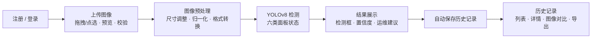

# 光伏面板缺陷检测系统 产品需求文档（PRD）

| 项目 | 内容 |
|---|---|
| 项目名称 | 光伏面板缺陷检测系统 |
| 产品形态 | 基于YOLOv8的B/S架构WebApp |
| 文档版本 | V1.0.0 |
| 编写日期 | 2026-09-14 |
| 文档状态 | 已确认（2026-09-14，待确认项按spec.md建议默认值执行） |
| 编制依据 | 《光伏面板缺陷检测系统项目任务书V1.0.0》 |

配套文档：系统架构见 [architecture.md](architecture.md)，数据库设计见 [db_design.md](db_design.md)，项目目录结构见 [project_structure.md](project_structure.md)，技术方案规格见 [spec.md](spec.md)。

## 1 业务背景

### 1.1 项目背景

光伏组件长期暴露于户外环境，积灰遮挡、鸟粪沉积、电损伤热斑、物理破损与积雪覆盖会显著降低发电效率，局部热斑甚至可能引发组件烧毁与火灾隐患。大型电站组件数量动辄数万块，依靠人工逐板巡检效率低、成本高、漏检率高，难以满足精细化运维需求，电站需要自动化、可复制的智能巡检手段。

以YOLOv8为代表的单阶段目标检测算法在检测精度与推理速度之间取得了良好平衡，配合无人机航拍与现场拍照采集，能够自动定位并分类面板异常状态，显著缩短巡检周期。目标检测技术已成为光伏电站智能运维的核心支撑技术之一，相关数据集与开源生态也日趋成熟。

B/S架构的Web应用无需安装专业软件，运维人员通过电脑或手机浏览器即可上传巡检图像并获取检测结论，便于在巡检现场即时使用，也为教学实训提供了完整的"数据-模型-应用"实践案例。

### 1.2 项目价值

- **业务价值**：自动识别积灰、鸟粪、损伤等异常状态并定位其位置，帮助运维人员快速生成清洗与检修工单，缩短故障处置周期，减少发电量损失。
- **技术价值**：实践YOLOv8目标检测模型的标注、训练、评估与部署全流程，探索检测模型在工业运维场景中的工程化应用方法。
- **社会价值**：提升光伏电站智能运维水平，延长组件寿命、提高清洁能源产出，助力新能源资产保值增效。

## 2 总体目标

开发一款基于YOLOv8的光伏面板缺陷检测Web应用：用户通过浏览器上传光伏面板巡检图像，系统自动检测面板状态与缺陷类别（清洁、积灰、鸟粪、电损伤、物理损伤、积雪），提供目标框位置、置信度与运维建议。

## 3 用户与使用场景

### 3.1 目标用户

| 用户 | 说明 | 核心诉求 |
|---|---|---|
| 光伏电站运维/巡检人员 | 主要用户，在巡检现场或办公室使用 | 快速获知面板缺陷类别与位置，据此安排清洗与检修 |
| 教学实训学员 | 次要用户，依托系统学习AI工程化 | 完整体验"数据-模型-应用"链路 |

系统为单角色系统，不做多角色权限划分；所有登录用户功能一致，数据范围仅限本人（见5.5、5.6）。

### 3.2 核心使用场景

1. **现场巡检检测**：巡检人员在现场用手机或电脑浏览器打开系统，登录后拖拽或点选上传巡检图像，随后看到检测框、类别、置信度与运维建议。
2. **事后复盘与工单**：运维人员打开历史记录，回看过往检测结果，对比原图与标注结果图，导出检测记录用于工单与归档。
3. **账户维护**：新用户注册，已有用户登录、修改个人信息与密码。

## 4 检测类别与运维建议

系统检测6类面板状态，类别顺序与命名沿用任务书及数据集定义：

| 类别ID | 类别名称 | 数据集英文标识 | 状态说明 | 运维建议 |
|---|---|---|---|---|
| 0 | 清洁 | Clean | 面板表面无遮挡、无明显缺陷 | 状态正常，维持现有巡检周期 |
| 1 | 积灰 | Dusty | 表面灰尘沉积造成遮挡 | 安排清洗作业，恢复发电效率 |
| 2 | 鸟粪 | Bird-drop | 鸟粪沉积，局部遮挡 | 尽快局部清洁，防止长期遮挡引发热斑 |
| 3 | 电损伤 | Electrical-damage | 电弧、热斑导致的烧蚀痕迹 | 安排停机检查与专业检修 |
| 4 | 物理损伤 | Physical-Damage | 破裂、崩边等机械损伤 | 评估损伤程度，安排检修或更换 |
| 5 | 积雪 | Snow-Covered | 积雪覆盖面板 | 视积雪与发电情况安排除雪或等待自然融化 |

运维建议为系统内置文案，随检测结果一并展示；建议内容不构成处置决策依据，处置决策由专业人员作出（见第9章免责声明）。

## 5 功能需求

系统包含6个功能模块，需求编号规则为 FR-模块号.功能点号。每条需求描述业务逻辑（触发、处理、输出）与规则约束。

### 5.1 图像上传模块（FR-1）

**FR-1.1 拖拽上传 / FR-1.2 点击选择上传**：用户在检测页将图像文件拖入上传区，或点击上传区唤起文件选择器选择图像，两种入口的校验规则与后续行为完全一致。系统为单图检测模式，每次上传并检测一张图像。

**FR-1.3 图像预览**：文件通过校验后，上传区展示图像缩略预览，并显示文件名、格式与文件大小；用户确认后发起检测。

**FR-1.4 格式校验**：仅接受 jpg、jpeg、png、bmp 四种格式。前端依据扩展名与文件类型拦截，后端对上传内容二次校验，防止绕过前端提交非法文件。

**FR-1.5 大小校验**：单文件大小不超过上限值，超限文件拒绝上传并提示上限值。上限值 [待确认 D2，建议10MB]。

页面由四块区域组成：上传热区（拖拽与点选入口）、预览区（缩略图与文件信息）、操作区（确认检测按钮，未选择文件时禁用）、提示区（校验错误与上传、检测状态反馈）。

边界与异常：

- 不支持的格式（如 webp、gif、tiff、pdf）→ 拒绝，提示支持的格式列表
- 超过大小上限 → 拒绝，提示上限值
- 文件损坏或伪装扩展名（后端解码失败）→ 返回"图像无法解析"错误
- 上传过程中网络中断 → 提示失败原因并允许重试

### 5.2 图像预处理模块（FR-2）

**FR-2.1 尺寸调整**：将上传图像缩放至检测模型要求的输入尺寸，保持长宽比，多余区域填充。

**FR-2.2 归一化**：将像素值转换为模型要求的数值范围。

**FR-2.3 格式转换**：将 jpg/png/bmp 解码并统一为推理所需的内部格式（RGB三通道图像）。

预处理在服务端执行，对用户透明，无独立页面。输入为通过校验的图像文件，输出为模型可接受的图像张量；解码或预处理失败的图像直接返回错误，不进入检测。具体参数（输入尺寸、归一化方式）见 spec.md 第6章。

### 5.3 深度学习识别模块（FR-3）

**FR-3.1 面板状态检测**：基于COCO预训练的YOLOv8迁移学习训练六类面板状态检测模型，对预处理后的图像执行目标检测，对每个检出目标输出类别（6类之一）、置信度、目标框位置坐标。

**FR-3.2 检测结果输出**：检测结果以结构化数据（目标列表）返回前端，同时生成渲染检测框的标注结果图。

**FR-3.3 模型性能要求**：模型精度与速度须满足 mAP@0.5 ≥ 75%、主要缺陷类别召回率 ≥ 80%、单张图像推理耗时 ≤ 200ms（口径见第6章）。

**FR-3.4 空结果处理**：图像中未检出任何目标时，返回"未检出目标"的正常结果，不作为错误处理。

规则约束：

- 置信度低于阈值的目标不计入结果 [阈值待确认 D7，建议0.25]
- 模型仅识别第4章定义的6类状态，不输出其他类别
- 每条检测记录保存推理耗时与模型版本号，用于性能指标复核与模型追踪

数据与训练侧要求（工程细节见 spec.md 第6章）：使用Kaggle "Solar Panel Images"数据集，用LabelImg补充目标框标注并转换为YOLO格式，按8:1:1划分训练/验证/测试集；针对类别分布不均采用加权采样与数据增强（随机翻转、旋转、亮度扰动、Mosaic拼接）；训练采用COCO预训练权重迁移学习、边框回归与分类联合损失、SGD/AdamW优化器配合余弦退火学习率、结合验证集mAP早停；部署前经量化、剪枝与ONNX导出优化。

数据集现状说明 [调研已确认]：该Kaggle数据集为分类数据集，图像按6类文件夹组织，无边界框标注，各类图像约100–900+张不等。目标框标注需在数据构建阶段用LabelImg完成，标注策略见 spec.md 待确认决策点 D1。

### 5.4 结果展示模块（FR-4）

**FR-4.1 检测框渲染**：检测完成后，页面在原图上叠加渲染检测框与类别标签，不同类别使用可区分的框色与标签样式。

**FR-4.2 置信度可视化**：以可视化方式展示各目标的置信度，与检测框一一对应。

**FR-4.3 运维建议展示**：按检出类别展示对应运维建议（映射见第4章），同类建议去重汇总。

**FR-4.4 结果汇总**：展示本次检测的检出目标列表（类别、置信度）与整体状态结论（如"检出积灰、鸟粪两类异常"）。

结果页由三块区域组成：结果图区（叠加检测框的标注图，可缩放查看）、检出目标列表区（每个目标的类别与置信度）、运维建议区。检测结果同时自动写入历史记录（见FR-5.1）。

边界与异常：未检出目标 → 展示空结果说明与原图；检测服务异常 → 明确错误提示，不展示部分结果。

### 5.5 历史记录模块（FR-5）

**FR-5.1 检测历史保存**：每次检测完成后，系统自动保存一条检测记录，内容包括原始图像、标注结果图、结构化检测结果、缺陷类别汇总、检测时间与推理耗时。保存动作对用户透明，无需手动操作。

**FR-5.2 历史列表查看**：历史记录页按检测时间倒序分页展示当前用户的检测记录，每条记录显示检测时间、图像缩略图与缺陷类别汇总。

**FR-5.3 检测详情查看**：点击某条记录进入详情页，查看该次检测的完整结果（原图、标注结果图、目标列表、运维建议）。

**FR-5.4 图像对比**：详情页支持原图与标注结果图的对比查看。

**FR-5.5 记录导出**：用户可将检测记录导出为文件 [格式待确认 D3，建议CSV]。

数据范围：用户只能查看与导出自己的检测记录；记录与账户绑定，账户删除时其检测记录级联删除（见 db_design.md）。

边界与异常：无历史记录 → 空状态提示；导出失败 → 错误提示并保留页面数据。

### 5.6 用户管理模块（FR-6）

**FR-6.1 注册**：用户提交用户名与密码完成注册，注册成功后进入登录态。邮箱为可选字段 [待确认 D8]。

**FR-6.2 登录**：用户输入用户名与密码登录，校验通过后建立登录态，后续请求携带登录凭证。凭证错误时统一提示"用户名或密码错误"，不区分具体错误项。

**FR-6.3 个人信息管理**：登录用户可查看与修改个人信息（昵称、邮箱），可修改密码（需验证原密码）。

**FR-6.4 数据安全**：密码以加盐哈希存储，系统任何环节不保存明文密码；登录凭证经HTTPS传输（见第7章）。

字段规则：

| 字段 | 必填 | 规则 | 唯一性 |
|---|---|---|---|
| 用户名 | 是 | 2–30个字符，支持字母、数字、下划线与中文 [字符集待确认] | 唯一 |
| 密码 | 是 | 至少8位，须包含字母与数字 [强度规则待确认] | — |
| 邮箱 | 待确认 | 符合邮箱格式 | 唯一（填写时） |
| 昵称 | 否 | 不超过30个字符 | — |

边界与异常：用户名或邮箱已被注册 → 提示已被占用；原密码验证失败 → 拒绝修改密码并提示；未登录访问受保护页面 → 跳转登录页。

### 5.7 整体业务流程

## 6 非功能需求

### 6.1 模型性能指标

| 指标 | 目标值 | 度量口径 |
|---|---|---|
| mAP@0.5 | ≥ 75% | 测试集上六类总体平均精度均值（IoU阈值0.5） |
| 主要缺陷类别召回率 | ≥ 80% | 积灰、鸟粪、电损伤、物理损伤、积雪五类缺陷类别的召回率 |
| 单张图像推理耗时 | ≤ 200ms | 服务端单张图像推理耗时，不含上传传输与页面渲染；测试硬件环境 [待确认 D6] |

### 6.2 安全性

- 传输安全：全站HTTPS加密传输
- 密码安全：加盐哈希存储，不落明文
- 存储安全：数据库存储加密 [落地方式待确认 D5]
- 权限隔离：用户仅能访问自己的检测记录与图像

### 6.3 兼容性与适配

- 浏览器：Chrome、Firefox、Safari、Edge 最新两个版本
- 响应式设计：适配PC端与移动端浏览器

## 7 数据隐私保护约束

巡检图像可能包含电站地理位置、设备编号等敏感信息，系统建设与运行遵守以下约束：

1. 传输环节采用HTTPS加密，防止图像与账户数据在传输中被窃取或篡改；
2. 数据库采取存储加密措施（落地方式见 spec.md 决策点 D5）；
3. 严格遵守数据保护法规，用户数据（账户信息、巡检图像、检测记录）不得用于本系统检测服务以外的任何用途；
4. 用户数据与账户绑定，不向其他用户暴露。

## 8 模型适用范围与局限性

以下适用边界须在系统界面与项目文档中如实告知用户：

1. 模型仅针对清洁、积灰、鸟粪、电损伤、物理损伤、积雪六类面板状态，不支持其他类别；
2. 对热斑等需红外成像才能发现的缺陷、细微裂纹，识别能力有限；
3. 在夜间、逆光、无人机拍摄角度剧烈变化等场景下，检测性能会下降；
4. 输入图像应为可见光RGB巡拍图像，红外成像、严重遮挡等非常规输入不适用。

## 9 项目免责声明

以下声明须随系统展示（展示位置 [待确认 D9，建议检测结果页底部与关于入口]），并写入项目文档：

> 本系统仅作为光伏面板运维巡检的辅助工具，检测结果不能替代运维人员现场复核与专业仪器检测，缺陷确认与检修处置决策应由专业人员作出。

## 10 术语表

| 术语 | 说明 |
|---|---|
| B/S架构 | Browser/Server架构，用户通过浏览器访问服务端，无需安装客户端软件 |
| YOLOv8 | Ultralytics发布的单阶段目标检测算法，兼顾检测精度与推理速度 |
| 目标框/检测框 | 标记检测目标位置的矩形框，由左上角与右下角坐标表示 |
| 置信度 | 模型对检测结果正确性的概率估计，取值0–1 |
| mAP@0.5 | IoU阈值取0.5时的平均精度均值，衡量检测模型整体精度 |
| 召回率 | 实际存在的目标中被正确检出的比例 |
| IoU | 交并比，预测框与真实框的重叠程度度量 |
| 迁移学习 | 加载COCO预训练权重后继续训练，加速收敛并提升小数据集上的效果 |
| 数据增强 | 随机翻转、旋转、亮度扰动、Mosaic拼接等图像变换，扩充有效训练样本 |
